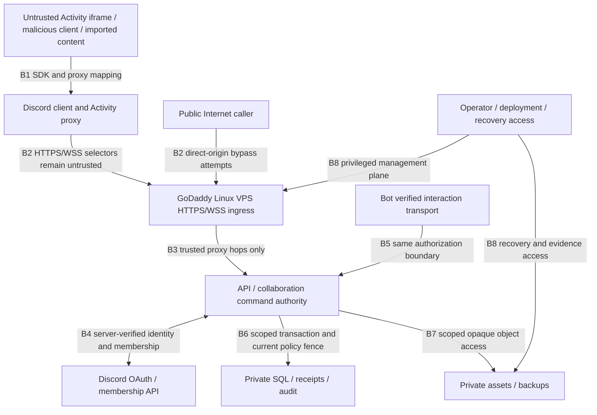

# GB-T9.R1: threat-model research v1

Status: **proposed research; awaiting actual security/consumer review**.
Issue: [#292](https://github.com/CompleteTech-DiscordApps/guildboard/issues/292).
Research date: 2026-10-25 UTC. Repository baseline: `ac4f656` (package version
`0.0.0`, reserved runtime modules). No Guildboard service or external test tenant
was running in this experiment. This document recommends security invariants for
the next specification; it does not accept architecture or implement controls.

## Scope, inputs and assumptions

The campaign supervisor verified Project 7 item #292 as Ready / Backlog /
Unblocked / Research. Direct native `blocked_by` returned `[]`; issue comments
and all open PR titles showed no competing T9 research owner before the claim.
The issue's GraphQL `projectItems` returned no nodes, so that endpoint alone was
not used as evidence of absent Project membership. No dependencies were changed.

Reviewed local inputs: [architecture boundary proposal](../architecture.md),
[T9 scope](../workstreams/T9.md), [security policy](../../SECURITY.md),
[configuration contract](../../planning/configuration-contract.md), and
[draft system contract #481](https://github.com/CompleteTech-DiscordApps/guildboard/pull/481)
at `95eeab122e68e37e28c1dfc9e1b8740785e3338a`. The latter is an information input,
not an accepted contract or sequencing waiver. No runtime/SDK/database/Nginx/OS
binary version was evaluated. #477's SDK 2.5.0 artifact research is not evidence
that its OAuth, browser or networking behavior was exercised here.

Assumptions to challenge in review: guild is the primary tenant; boards may have
stricter visibility than guild membership; compromised clients can emit arbitrary
requests; an ordinary writer, moderator or another guild's administrator may be
hostile; the public VPS origin is reachable without Discord's proxy; operators
and dependencies can be compromised. Discord's proxy does not authenticate a
Guildboard principal. A guild administrator is not a cross-tenant administrator.
Single-VPS failure and a fully compromised root operator remain residual risks.

## Primary-source observations and evaluated versions

All linked pages were inspected on 2026-10-25 UTC. Rolling pages do not expose a
stable release version. [Fetch metadata](t9-source-observations.json) records
10 successful HTTPS GET observations, retrieval timestamps, final URLs and SHA-256
of received bytes. Hashes identify those responses, not permanent vendor content,
semantic truth or platform acceptance. Bodies are not redistributed. A later fetch
may legitimately differ. These observations support the facts below; recommendations
and priority judgments elsewhere are Guildboard-specific analysis.

| ID / primary source | Version/date and relevant observed fact |
| --- | --- |
| D1 [Discord: how Activities work](https://docs.discord.com/developers/activities/how-activities-work) | Rolling; Activity runs inside Discord iframe, SDK manages postMessage communication. SDK ready/launch data is not server membership proof. |
| D2 [Discord: networking](https://docs.discord.com/developers/activities/development-guides/networking) | Rolling; Activity requests traverse proxy and configured mappings. Client data is untrusted and unsanitized. Proxy cookie guidance uses the application's exact `discordsays.com` domain and `SameSite=None; Partitioned`. |
| D3 [Discord: OAuth2](https://docs.discord.com/developers/topics/oauth2) | OAuth 2.0 rolling API guide; state binds authorization to a user request; token exchange uses form encoding. `identify`, `guilds` and `guilds.members.read` expose different data, not equivalent authorization. |
| D4 [Discord: permissions](https://docs.discord.com/developers/topics/permissions) | API v8+ permission values serialized as strings; big-integer handling recommended. Guild roles and channel overwrites affect permissions; Discord administrator bypasses Discord channel overwrites, not Guildboard tenancy. |
| D5 [Discord: first Activity tutorial](https://docs.discord.com/developers/activities/building-an-activity) | Rolling tutorial; example uses server-side client secret, returns access token to iframe for SDK authenticate and shows empty state. This is an example, not a complete production security design. |
| O1 [IETF OAuth security BCP](https://www.rfc-editor.org/rfc/rfc9700.html) | RFC 9700 / BCP 240, January 2025, §§2.1, 2.2, 4.7: protect code/CSRF flows, exact redirect matching, transaction binding; public clients require PKCE, recommended for confidential clients. Provider support must be established before relying on PKCE for CSRF. |
| O2 [OWASP WebSocket security](https://cheatsheetseries.owasp.org/cheatsheets/WebSocket_Security_Cheat_Sheet.html) | Rolling author guidance; WSS, explicit origin allowlist, ongoing session and per-message authorization, resource bounds and safe security logging. Origin is a browser defense, not principal identity. |
| O3 [OWASP file upload security](https://cheatsheetseries.owasp.org/cheatsheets/File_Upload_Cheat_Sheet.html) | Rolling author guidance; declared MIME alone is insufficient, use content/size checks, generated names, restricted storage and authorized retrieval. Decoder/parser resource limits matter. |
| N1 [Nginx WebSocket proxying](https://nginx.org/en/docs/http/websocket.html) | Rolling; Upgrade/Connection need explicit proxy handling. Page distinguishes configuration before 1.29.7 and describes default 60-second upstream inactivity timeout; installed version/config remains unknown. |
| G1 [GoDaddy: secure VPS SSH](https://www.godaddy.com/help/secure-the-ssh-port-on-my-vps-hosting-42465) | Rolling VPS Hosting help; firewall/SSH access needs deliberate administration. No purchased plan, image, firewall, support arrangement or secure default was verified. |

The first attempted GoDaddy article (`securing-my-vps-hosting-using-ssh-8663`)
was inaccessible through the web tool; G1 is the successfully inspected replacement.
No conclusion depends on the failed page.

## Assets, actors and trust boundaries

| Asset | Security property / authorized access |
| --- | --- |
| OAuth/bot/client secrets, refresh/access tokens, session handles | Server secrets outside source/images; any token required by SDK restricted to necessary client lifetime; never in URLs/logs/exports. Session bound to server-verified identity, expiry and revocation. |
| Board elements, assets, exports, snapshots and history | Confidentiality by guild **and board**; integrity by current policy; deletion covers retained copies under explicit policy. Public IDs provide no authority. |
| Membership/roles, grants, restrictions, mode/presenter/lock state | Authoritative freshness and ordering; no self-grant, moderator escalation or grant bypass of lockdown. |
| Revisions, operation receipts, lineage, outbox, audit | Durable ordered acceptance, scoped replay, tamper evidence and minimal actor/action metadata. |
| VPS, database, storage, backups, DNS/TLS and deployment credentials | Least privilege, private data plane, recoverability and bounded shared-resource impact. |



This is an analysis diagram, not a deployed topology. B1 must treat client guild,
role, user and channel values as selectors; unknown postMessage senders and
unexpected SDK messages fail closed. B2 includes reads, HTTP commands, WSS
upgrade, join, replay, presence and asset fetch. B3 cannot trust public forwarded
headers to set identity, scheme, host or a rate-limit key. B4 requires token
validation plus trusted membership/channel evidence, not a decoded client claim.
B5 needs the chosen interaction transport's provenance verification and replay
handling before invoking the same command authority. B6 must serialize policy
changes with writes; B7 must prevent traversal, tenant crossover and public cache
leaks. B8 includes provider account/MFA, SSH, CI supply chain, root, backups and
incident access, not just application HTTP routes.

## Prioritized abuse and security acceptance register

Scores are ordinal research judgments, not measured exploitability or CVSS.
Impact I: 3 = tenant/credential compromise or permanent loss; 2 = bounded data
exposure/outage; 1 = limited disruption. Likelihood L: 3 = reachable with ordinary
client/request access; 2 = timing, privileges or operational condition required;
1 = unusual prerequisite. P0 = I=3 and L>=2; P1 = remaining I*L>=4; P2 = rest.
P0 controls gate any exposed relevant capability; P1 controls gate its release.
All runtime assertions below are **pending**, not passed by this document.

| ID / risk / boundaries / owner | Attack and recommended mitigation | Observable acceptance required |
| --- | --- | --- |
| A01 P0 I3/L3, B1/B4, T1/T2 | Forge SDK user/guild/role/admin fields or use membership from another guild. Resolve identity and minimum necessary membership/channel data on server; deny unknown/stale evidence. D1–D4. | Two controlled guilds; forged user/role/channel, removed member and Discord API outage. Legitimate member allowed; foreign/missing/stale authority denied with no content, receipt or broadcast. Record evidence freshness and invalidation bound. |
| A02 P0 I3/L3, B2/B6/B7, T2/T5/T8 | Guess foreign board/asset/receipt IDs or share cache/room/idempotency keys across tenants. Scope every lookup, join, cache key, operation identity, object reference, export and recipient. | Matrix across every HTTP/socket/bot/storage route: guild A principal with guild B selectors; same-guild restricted board; colliding operation IDs. Unknown and foreign resource have same safe public outcome; no foreign data/existence leakage or mutation. Trace storage, cache and egress effects. |
| A03 P0 I3/L3, B1/B2/B4, T1/T8 | Inject/replay a code, fix a session, steal a token via script/log/query or force OAuth exchange from another browser. Bind single-use authorization transaction and session; exact redirect/origin policy; server-only secrets, bounded expiry/rotation, redacted errors. D3/D5/O1. | Wrong/missing/reused/expired state, foreign transaction/code, expired/revoked session, malicious redirect, parallel redemption. Deny without session creation; capture URL/log/export/client-bundle sentinels. Verify actual chosen SDK code-binding and supported PKCE behavior before acceptance. |
| A04 P0 I3/L3, B2/B3, T1/T8/T10 | Cross-site socket hijack, spoof Origin/Host/forwarded headers, unauthenticated join or direct-origin bypass. Exact observed origin allowlist plus session/CSRF binding; trust only configured proxy hops; all ingress paths authenticate. D2/O2. | Approved Discord clients succeed; hostile/sibling/suffix/null/missing origins and forged proxy headers fail according to explicit transport policy. Non-browser callers cannot gain authority by setting allowed Origin. Test both proxy and public VPS origin with real cookies. |
| A05 P0 I3/L2, B5/B6, T2/T4/T5/T6 | Revoke a grant, remove membership, expire session or lock board while an edit is queued. Serialize current authority/generation with commit; a later regrant must not revive stale intent. No authorization solely at WSS join. | Deterministic prepare/revoke/commit and prepare/revoke/regrant/commit races; commit-before-revoke valid, commit-after invalid. Barrier-controlled real SQL tests with two workers, stale cache and connected clients. Denied edit causes no new durable content/revision/receipt/outbox; only bounded authorized denial-audit metadata may be added. Local model below is partial reasoning only. |
| A06 P0 I3/L2, B5/B6, T2/T6/T8 | Writer self-grants or moderator changes admin mapping, unlocks emergency lockdown or abuses presenter mode. Enumerate actions/capabilities; unknown actions deny; bot and HTTP use same policy. | Role/action matrix including self-approval, moderator-to-admin, expired grants, all modes and lockdown override. Assert legitimate administrative transition plus unauthorized transition denial, consistent policy generation and audit. |
| A07 P0 I3/L3, B1/B2/B7, T3/T5/T7 | Stored XSS in labels/usernames/imported elements; malicious URL, SVG, polyglot, path traversal, SQL injection or SSRF via asset fetch. Safe rendering, typed bounded schemas, parameterized SQL, opaque scoped assets, quarantine and no arbitrary remote fetch. D2/O3. | Hostile text/URLs rendered inert; active content and mismatched/decoded oversized files rejected before publication; traversal/SQL sentinels produce no filesystem/SQL effects. SSRF tests cover redirects, private/link-local addresses and DNS changes if fetching is enabled; otherwise prove no fetch path. |
| A08 P0 I3/L2, B6, T4/T5/T8 | Retry a committed operation with changed payload, reuse another actor's receipt, acknowledge before commit or replay stale lineage after restore. Scope identity/digest; atomic durable operation+receipt+event; current read permission before receipt disclosure. | Lost ACK/concurrent duplicate/crash/rollback tests; identical retry returns only authorized receipt without another mutation; changed digest conflicts; stale lineage fails; restored board cannot resurrect revoked/deleted content. Model does not cover receipts/durability. |
| A09 P1 I2/L3, B2/B3/B7, T4/T5/T8/T10/T11 | Flood connections/messages/uploads, decompression bombs, slow consumers, full disk or amplification through exports. Bound bytes/decoded work, rates, queues, connections, time and storage at user/board/guild/global levels; isolate cleanup. O2/O3/N1. | Agreed finite limits at below/at/above boundary, compressed and slow requests. Reject/close over-budget work and recover clients; unaffected guild retains agreed service under declared load; accepted durable edits preserved. Numerical budgets remain a specification/load gate. |
| A10 P0 I3/L2, B3/B8, T10/T11 | Internet reaches SQL/debug/admin services, leaked .env or asset directory; weak SSH/provider account, vulnerable package or stale TLS renewal compromises host. Private listeners, firewall allowlist, non-root services, protected secrets, patched pinned dependencies, verified renewal and operator access. G1/N1. | Authorized external IPv4/IPv6 port inventory against exact VPS; only approved public services reachable, SQL/assets/debug private. Verify file permissions and redacted config, DNS/mappings, TLS chain/renewal, WSS idle/reconnect, operator MFA/SSH and rollback. Record plan/image/package versions; vendor help is not deployment proof. |
| A11 P0 I3/L2, B6/B7/B8, T5/T9/T11 | Moderator edits audit trail; tokens/content leak in logs/backups; deletion leaves assets/exports/snapshots accessible; restore revives deleted data. Append-restricted audit, minimal collection, scoped access, explicit deletion/retention and recovery policy. | Credential/content sentinels absent from diagnostics; unauthorized audit read/write denied; deletion inventory tracks live objects, replicas, caches and backup expiry; restored isolated system reapplies deletion/revocation requirements. Actual restore/access drill and retention decisions still required. |

Safe denials must not leak payloads, secrets, SQL details or foreign resource
existence. A denial can emit minimal protected security metadata; "no side effects"
here means no unauthorized product/durable/broadcast effect, not prohibition of
the security audit itself. Audit write failures need an explicit fail/queue policy.

## Alternatives and recommended direction

| Decision | Alternatives / tradeoff | Research recommendation and unresolved question |
| --- | --- | --- |
| Session in Discord iframe | Partitioned HttpOnly cookie reduces script token access but needs proxy/browser support and CSRF defenses. In-memory app bearer avoids ambient cookies but XSS can read it; persistent browser storage increases exposure. | Prefer short-lived server session with minimal client exposure, evaluate proxy cookie transport first. D2's iframe requirements conflict with generic SameSite=Lax/Strict examples; do not copy those settings blindly. Add Secure/HttpOnly where appropriate, exact scope and tested CSRF/origin controls. Record desktop/web/mobile compatibility before selecting. |
| OAuth transaction | Copying tutorial's empty state is easy but does not establish a complete binding defense. Generic redirect OAuth with state/PKCE may differ from SDK flow. | Bind each backend exchange to the initiating browser/session and consume once; evaluate SDK and provider code/state/PKCE support against O1. Do not assert PKCE works, that token never enters iframe (D5 needs SDK authenticate), or that state alone solves all code injection. Unresolved until T1 real-flow evidence. |
| Membership authority | Client cache is fast but forgeable; server TTL cache reduces API cost but has a stale window; per-command REST can be costly/rate-limited and still needs commit fencing. | Server-verified evidence with explicit expiry and invalidation; privileged mutations fail closed when evidence is unavailable/stale. T1/T2 must agree freshness, outages, channel restrictions and invalidation behavior; local generation cannot detect an unobserved Discord role change. |
| Revocation ordering | Check-at-handshake/prepare leaves a race. Atomic policy/command transaction or an equivalent provable sequencer fence can establish ordering; asynchronous revoke notification alone cannot. | Specify commit-time fence and test both orders. Do not select lock order, isolation level, CRDT/OT or new architecture here. T2/T4/T5 own accepted implementation and cross-worker proof. |
| Hosting / ingress | Required GoDaddy Linux VPS plus private services; adding CDN/WAF may help ingress but does not replace identity, tenant checks or VPS duties. Shared origin/public assets simplify setup but expose bypass paths. | Preserve GoDaddy target and private data plane. Evaluate actual plan/image/support boundary and external reachability before deployment; no purchase, migration or provider substitution authorized by this research. |

## Deterministic experiment and its limits

The [model](../../scripts/research/t9-revocation-model.py) compares prepare-only
permission checking with an **assumed atomic** generation/current-authority
check at commit. It enumerates all 1,364 traces of length 1–5 over prepare,
revoke, grant and commit for each design. A negative control must accept a stale
or revoked preparation, otherwise the experiment is not sensitive to the race.
The fenced model must produce zero such acceptances. A commit consumes the toy
preparation; this is not a runtime idempotency/receipt design.

Reproduce from repository root (Python standard library only):

```sh
python tests/research/t9-test-revocation-model.py -v
python scripts/research/t9-revocation-model.py
python scripts/github-bootstrap/validate.py
git diff --check
```

The checked-in [model report](t9-revocation-model-evidence.json) is deterministic
and can be compared byte-for-byte with CLI stdout. Tests check the counterexample,
valid writes, no preparation, repeated commit, revocation/regrant, rejected-state
preservation and exhaustive experiment totals. They establish this finite model's
behavior only. It has one actor/object, no tenant implementation, no SQL lock,
session, clock expiry, network, Discord callback or crash. Atomicity is assumed;
neither linearizability nor product enforcement is proven. The tests are run by
the explicit command above; this proposal does not change hosted CI workflows.

Local execution: Windows PowerShell, Python 3.14.3, 2026-10-25 UTC. All eight
research tests passed. Across 1,364 traces per design the prepare-only negative
control admitted **132 stale/revoked commit events**, versus **zero** with the
assumed commit fence. The report matched fresh CLI stdout byte-for-byte (SHA-256
`6f6c8199f8646e398ba19644abd84538277157e4cb8fd52856e847e93e0bc947`).
All 10 source metadata entries had successful HTTP results and valid response
hashes. Planning validation passed: 471 items, 457 expected native relationships,
600 expected dependencies, zero errors. The validator's unrelated CRLF-only
audit rewrite was restored to baseline; final whitespace validation passed.
The published PR records the full tested commit SHA and subsequent hosted status.

For an independent document refresh, retrieve a registered URL with an HTTPS
client and compare the response hash and UTC date; for example:

```sh
python -c "import hashlib,urllib.request; u='https://nginx.org/en/docs/http/websocket.html'; print(hashlib.sha256(urllib.request.urlopen(u,timeout=25).read()).hexdigest())"
```

A changed hash requires rereading the relevant claims, not updating a pass flag.
The stored hashes do not allow reconstruction of the original response bodies.

## Acceptance traceability, review and next evidence

| #292 scope clause | Observable research artifact / local result | Remaining acceptance |
| --- | --- | --- |
| Discord iframe and OAuth | B1–B4, A01/A03/A04, D1–D5/O1; documented source review and cookie/OAuth alternatives | T1 actual SDK code/transaction/session, scopes, cookie/origin/client matrix |
| Tenant isolation and permissions | Assets/B2/B5–B7, A01/A02/A06; route/object/egress negative-test plan | T2/T5/T8 exhaustive implemented route/socket/bot/storage allow/deny evidence |
| Authoritative edits | B6, A05/A08; executable finite counterexample and fenced comparison | T2/T4/T5 SQL ordering, retries, crash, restore and multi-worker tests |
| Public GoDaddy VPS | B2/B3/B8, A09/A10, G1/N1; vendor/proxy review and exposure plan | T10/T11 exact host/image/package inventory, authorized external checks and recovery |
| Prioritized abuse | A01–A11 with explicit I/L rubric, mitigation, owner and observable acceptance | Actual security reviewer challenges coverage, scores, residual risk and dispositions |
| Alternatives, URLs, versions/date, uncertainty | Source register/metadata; alternatives table; model v1 | Reviewed decision record in #293; immutable accepted contracts and evidence links |
| Integration evidence | T9 handoff plus reproducible commands and output | Actual functional Security Engineering and consumer review, hosted CI, CODEOWNER, merge and post-merge verification |

No real-environment check in this table has run. Required inputs are a controlled
Discord application/two-guild test membership and approved scopes; real desktop,
web and mobile clients; accepted session/policy/protocol/data specifications;
an authorized exact GoDaddy VPS target, DNS/TLS/mappings and operator access; an
isolated restore target and agreed retention/resource limits. Do not probe an
unidentified host, provision credentials, weaken native dependencies or mark a
runtime gate complete from this research.

Handoff: #293 consumes the controls/retention/security acceptance proposal;
T1/T2/T4/T5/T6/T8 implement their accepted boundaries; T10/T11 own infrastructure
and recovery; T12 maps A01–A11 to real tests; #467 and T13 retain release gates.
No reviewer identity, clean review, merged state or production security is claimed.
Any concrete vulnerability discovered later follows SECURITY.md privately.
